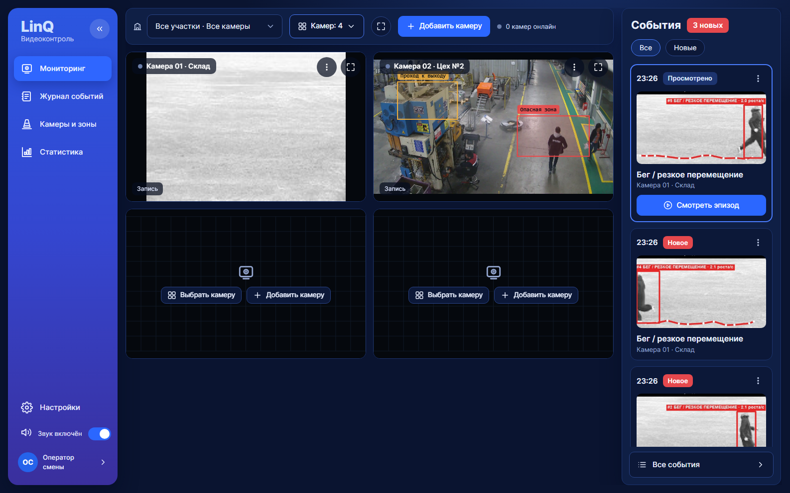
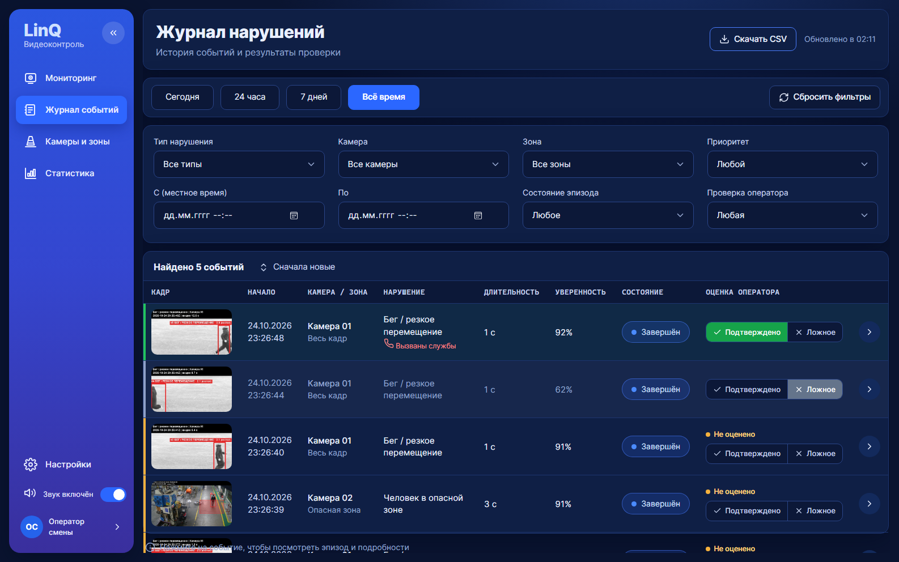
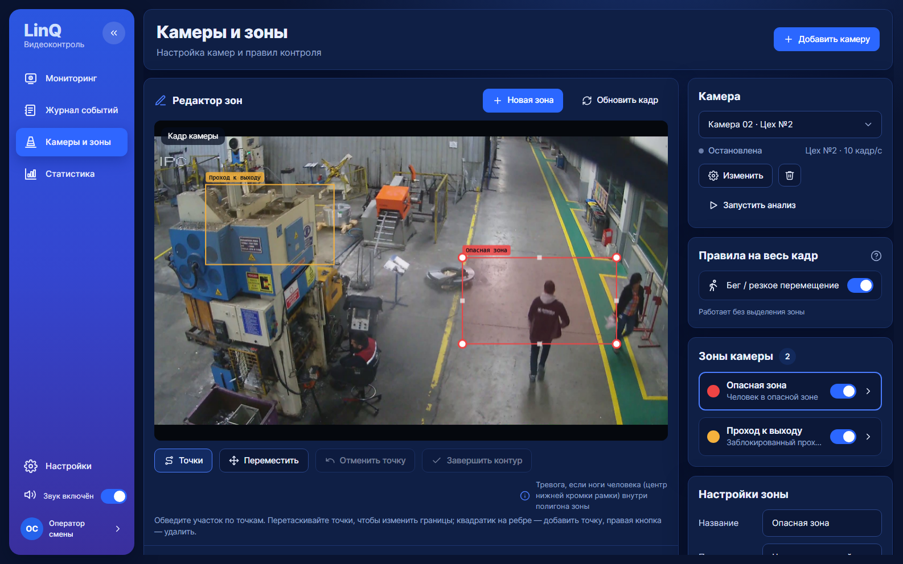
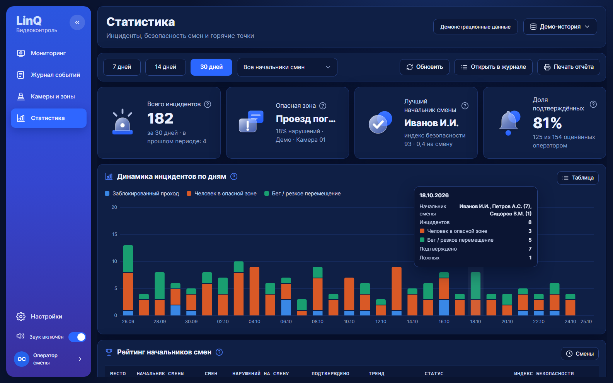

# LinQ Видеоконтроль — промышленная безопасность на нейроускорителе

Проект хакатона «Открой Моспром 2026», кейс LinQ. Это веб-система для диспетчера, специалиста по охране
труда и начальника смены. Камеры цеха анализирует нейросеть YOLOv8s: на LinQ TPU, на CPU или в виде
записи результатов LinQ. Правила находят опасные ситуации. Одно нарушение даёт одну тревогу в браузере с
кадром, видео эпизода и звуком. Оператор оценивает тревогу в один клик, может вызвать экстренные службы,
а руководство видит динамику, горячие точки и рейтинг начальников смен.

| Мониторинг | Журнал нарушений |
|---|---|
|  |  |
| **Камеры и зоны** | **Статистика** |
|  |  |

## Что умеет

**Сценарии нарушений**
| Сценарий | Что считается нарушением |
|---|---|
| Человек в опасной зоне | ноги человека (низ рамки) внутри зоны дольше окна подтверждения |
| Бег / резкое перемещение | скорость выше порога, в ростах человека в секунду; работает на весь кадр без зоны |
| Заблокированный проход | в зоне прохода появился посторонний неподвижный предмет; сравнение с эталоном «пустого прохода» |

Одна тревога на эпизод: нарушение подтверждается по времени, повторы подавляются, эпизод живёт, пока
длится нарушение. Время везде считается по видео, поэтому замедленное и ускоренное воспроизведение дают
одинаковые эпизоды.

**Экраны**
- **Мониторинг.** Сетка от 1 до 9 камер с живым кадром, рамками людей и состоянием зон. Кнопка «Запустить»
  прямо в ячейке, раскрытие камеры и полный экран. Справа — лента событий: «Все» и «Новые», скрыть,
  очистить. Отдельно — кнопка «Экстренный вызов».
- **Журнал нарушений.** Быстрые периоды и восемь фильтров, сортировка, CSV всей выборки, «Очистить всё».
  Оценка оператора в один клик: «Подтверждено» или «Ложное». Строки подсвечены по статусу. В карточке
  эпизода — видео с начала эпизода или кадр, история проверки, вызов экстренных служб, удаление события.
- **Камеры и зоны.** Черновик разметки камеры сохраняется одной операцией. Контуры рисуются и правятся
  точками, перемещаются целиком, проверяются на самопересечения. Каждая зона получает правило.
  «Начать анализ» показывает живой кадр прямо в редакторе. Здесь же правила на весь кадр, эталон «пустого
  прохода» и привязка записи LinQ.
- **Статистика.**
  - KPI: всего инцидентов, самая опасная зона, лучший начальник смены, доля подтверждённых.
  - Динамика по дням с разбивкой по сценариям: при наведении — начальник смены и разбивка, по клику —
    день в журнале.
  - Рейтинг начальников смен: нарушений на смену, тренд, «Лидер безопасности» / «Зона риска», индекс
    безопасности от 0 до 100.
  - Горячие точки по зонам и камерам.
  - Замеры скорости детектора с честной меткой среды выполнения.
  - Печать отчёта.

Интерфейс сделан по макетам в строгой тёмной теме, без сборки и внешних CDN: шрифт Inter (OFL) лежит
локально в `frontend/fonts`.

## Быстрый старт

Нужны Python 3.11+ (проверено на 3.12) и, по желанию, Node.js 18+ — только для проверки фронта.

**Windows (PowerShell)**
```powershell
git clone https://github.com/yvkrotova/Mosprom-hackaton.git
cd Mosprom-hackaton\backend
py -3.12 -m venv .venv
.\.venv\Scripts\python.exe -m pip install -r requirements.txt
copy .env.example .env
$env:PYTHONIOENCODING="utf-8"
.\.venv\Scripts\python.exe -m uvicorn app.main:app
```

**Linux / macOS**
```bash
cd backend
python3.12 -m venv .venv && .venv/bin/pip install -r requirements.txt
cp .env.example .env
.venv/bin/uvicorn app.main:app
```

Откройте **http://localhost:8000**: backend отдаёт и API, и интерфейс. Swagger — http://localhost:8000/docs.
Миграции базы применяются сами при старте.

**Посмотреть систему за минуту без камер и модели.** Откройте «Статистика» → «Демо-история» →
«Сгенерировать историю за 30 дней». Появятся 4 демо-камеры, 5 начальников смен и около 190 инцидентов
за 30 дней. Паттерны заложены специально:
- Иванов — лидер безопасности;
- Петров — зона риска;
- у Сидорова виден положительный тренд;
- остальные — стабильные средние.

Демо-данные помечены и удаляются тем же меню, реальные данные при этом не трогаются. Демо-камеры не
показываются в «Мониторинге»: видео у них нет.

**Добавить свою камеру.** «Мониторинг» → «Добавить камеру» → видеофайл. Анализ запустится сам, правило
бега создастся по умолчанию. Опасные зоны рисуются в «Камерах и зонах».

## Детектор: где работает нейросеть

Выбирается в `backend/.env` (`DETECTOR=…`). Интерфейс и `/metrics` всегда честно показывают среду выполнения.

| Режим | Что это | Метка в интерфейсе |
|---|---|---|
| `mock` | заглушка без нейросети (демо сценариев, тесты) | «Заглушка (mock) · не LinQ» |
| `onnx` | YOLOv8s через onnxruntime на CPU компьютера | «ONNX · CPU (не LinQ)» + предупреждение |
| `linq` | живой инференс на LinQ TPU (нужны VPN и доступ к сервису) | «LinQ TPU» |
| replay | предзаписанные результаты LinQ для конкретного видео | «Replay — предзаписанные результаты LinQ» |

**Модель YOLOv8s.** Положите `yolov8s.onnx` в `backend/models/`: веса в git не хранятся. Получить файл:
`yolo export model=yolov8s.pt format=onnx imgsz=640 opset=12 simplify=True` в окружении с ultralytics.

**LinQ, предзаписанные результаты (replay).**
1. В Jupyter организаторов загрузите в одну папку `linq/run_linq_detections.py` и из
   `backend/app/pipeline/detectors/` файлы `yolo_core.py`, `replay_format.py`, `linq_transport.py`.
   Туда же положите видео и `linq/notebooks/run_linq_detections.ipynb`.
2. Запустите ячейки по порядку. Notebook проверит окружение, спросит адрес и учётные данные сервиса — они
   хранятся только в памяти — и запишет `dets_linq_<видео>.jsonl`. Прерванный прогон продолжается с
   последнего кадра.
3. Локально приложите JSONL к видео в «Добавить камеру». Другой вариант — положить файлы в папку
   `REPLAY_DIR`: запись найдётся сама по SHA-256 видео.

Формат записи, сверка с видео (SHA-256, FPS, разрешение) и поведение при пропусках кадров описаны в
[backend/docs/CV_CONTRACT.md](backend/docs/CV_CONTRACT.md), раздел «Replay v2».

**LinQ, живой инференс:** [docs/LINQ_CONNECT.md](docs/LINQ_CONNECT.md). Если LinQ недоступен, это ошибка
источника. Тихой подмены на CPU нет.

## Основные настройки `backend/.env`

| Параметр | По умолчанию | Зачем |
|---|---|---|
| `DETECTOR` | `mock` | `mock` / `onnx` / `linq` / `replay` |
| `DETECTOR_CONF_THRESHOLD` | `0.1` | низкий порог нужен трекеру ByteTrack, правила отсекают слабые детекции сами |
| `REALTIME_PLAYBACK` | `false` | `true` — файл идёт в темпе реального времени (для показа) |
| `AUTO_START_ON_UPLOAD` | `true` | анализ стартует сразу после загрузки видео |
| `REPLAY_DIR` / `REPLAY_PATH` / `REPLAY_ON_MISSING` | — / — / `error` | записи LinQ (см. выше) |
| `EMERGENCY_CONTACTS` | `112:…;101:…;103:…` | номера для кнопки «Экстренный вызов» |
| `LINQ_*` | — | адрес и учётные данные LinQ, **только** здесь, никогда в коде и git |

Полный список с комментариями — `backend/.env.example`.

## Как устроено

```
Видео / поток ─▶ FrameSource ─▶ Detector ──────▶ Tracker ─▶ ScenarioRule(s) ─▶ EpisodeManager ─▶ backend API
                  (кадры по     (YOLOv8s:      (ByteTrack,   (чистые функции    (подтверждение,     (SQLite, REST,
                   analysis_fps) LinQ/CPU/      треки людей)  кадра: зона, бег,  одно событие на     WebSocket)
                                 replay)                      загромождение)     эпизод)                 │
                                                                                                         ▼
                                                                         браузер: тревога, журнал, статистика
```

- Один процесс-воркер на камеру: детектор, трекер и анализ сцены создаются один раз на поток.
  Изменения зон и правил подхватываются на лету.
- Правила — «стратегии» без состояния. Вся логика эпизодов живёт в `EpisodeManager`. Новый сценарий —
  один файл в `backend/app/pipeline/scenarios/`, сделанный по `_template.py`.
- Фронт не содержит логики под конкретный сценарий: названия, иконки, цвета и формы параметров он берёт
  из `GET /api/v1/scenarios`.

```
backend/   FastAPI, конвейер анализа, SQLite + Alembic, WebSocket, тесты. Подробно: backend/README.md
frontend/  интерфейс: ванильные ES-модули без сборки (их раздаёт backend), css/app.css, fonts/, design/
linq/      LinQ: генерация записей в Jupyter, калибровка, сравнение с ONNX, замеры
docs/      замеры, заметки по LinQ, разметка тестовых роликов
```

## API — коротко

Все запросы и поля описаны в [backend/docs/CONTRACT.md](backend/docs/CONTRACT.md). Основное:

| Что | Запрос |
|---|---|
| Камеры, загрузка видео (+ запись LinQ), запуск и остановка | `/api/v1/sources…`, `POST /sources/upload`, `/sources/{id}/start`, `/stop` |
| Разметка камеры одной операцией | `PUT /api/v1/sources/{id}/layout` |
| Журнал, CSV, просмотр, оценка в один клик | `GET /events`, `GET /events/export.csv`, `POST /events/{id}/view`, `POST /events/{id}/feedback` |
| Удаление | `DELETE /events/{id}`, `DELETE /events` (всё) |
| Экстренный вызов | `GET /emergency/contacts`, `POST /events/{id}/emergency` |
| Аналитика | `GET /analytics/overview?days=7\|14\|30&supervisor=&tz_offset_min=` |
| Смены начальников | `/api/v1/shifts…` |
| Демо-история | `POST /demo/history`, `DELETE /demo/history` |
| Замеры детектора | `GET /api/v1/metrics` |
| Живой кадр и события | WebSocket `/ws/live/{source_id}`, `/ws/events` |

Удаление надёжно: удалённое событие получает «надгробие», и если анализ ещё идёт, его обновления не
создают событие заново.

## Проверки

```powershell
cd backend
.\.venv\Scripts\python.exe -m pytest -q                                  # тесты backend
.\.venv\Scripts\python.exe -m ruff check . ; .\.venv\Scripts\python.exe -m ruff format --check .
cd ..\frontend
npm run check                                                             # синтаксис и импорты модулей
```

Тесты покрывают:
- конвейер, трекер и сценарии на синтетике;
- replay: формат, сверку с видео, повторный прогон без дублей;
- API экранов, аналитику и демо-паттерны;
- миграции: данные сохраняются;
- сквозной прогон с настоящим воркером.

Замеры скорости и качества на тестовых роликах — [docs/BENCHMARKS.md](docs/BENCHMARKS.md).

**Ручная проверка интерфейса**
- **Меню.** «««» сворачивает меню; анализ при этом не прерывается.
- **Нет связи с сервером.** Остановите backend — появится баннер «Нет связи с сервером», он уйдёт сам
  после запуска.
- **Мониторинг.**
  - «Камер: N» от 1 до 9, пропорции кадра сохраняются.
  - «Запустить» в ячейке стартует анализ на месте.
  - Лента событий: «Скрыть» и «Очистить» (события остаются в журнале).
- **Журнал.**
  - Оценка кликом по «Подтверждено» / «Ложное» меняет подсветку строки.
  - «Очистить всё» после подтверждения удаляет все события.
  - CSV выгружает всю выборку.
- **Камеры и зоны.** Нарисуйте контур, замкните его по первой точке и сохраните. Самопересекающийся
  контур не сохранится, ошибка появится у зоны. «Начать анализ» показывает живой кадр прямо в редакторе.
- **Статистика.**
  - Сгенерируйте демо-историю, наведите на столбец дня, щёлкните по нему, откройте день в журнале.
  - Отфильтруйте по начальнику смены. Проверьте «Печать отчёта».

## Ограничения

- `DETECTOR=onnx` работает на CPU, около 9 кадров в секунду. Это не LinQ, и интерфейс так и пишет.
  Скорость LinQ показывается только по живому инференсу или по записи с LinQ.
- Скорость бега измеряется в ростах человека в секунду при неподвижной камере. Порог 1,7 подобран на тестовых
  роликах.
- YOLOv8s (COCO) плохо видит очень мелких и сидящих людей.
- «Заблокированный проход» требует статичной камеры. Лучше всего он работает с сохранённым эталоном
  «пустого прохода».
- Система не звонит в службы сама: она показывает номера (ссылки `tel:`) и фиксирует, кто и куда
  позвонил.

> Логины, пароли и адреса (VPN, Jupyter, LinQ) хранятся только в `backend/.env`, который в `.gitignore`.
> Известное исключение, которое надо убрать: `backend/bridge_update/linq_bridge_server.py` (сервер-мост для
> Jupyter) содержит адрес сервиса LinQ, стандартные учётные данные RabbitMQ и путь с логином Jupyter.
> Их стоит вынести в переменные окружения.
